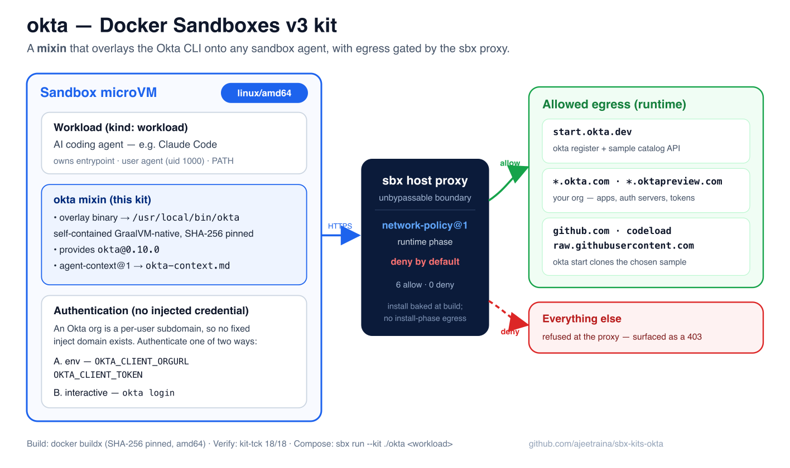

# sbx-kits-okta

[Docker Sandboxes](https://docs.docker.com/ai/sandboxes/) **v3 kits** for Okta.



## Kits

| Kit | Kind | Provides | Platform | Description |
|---|---|---|---|---|
| [`okta/`](./okta) | mixin | `okta@0.10.0` | `linux/amd64` | The [Okta CLI](https://github.com/okta/okta-cli) — register orgs, manage OIDC/SAML apps, scaffold samples. |

## Run from Docker Hub

The kit is published to Docker Hub — layer it onto any agent (needs an
**amd64** sandbox host; the Okta CLI ships no arm64 binary):

```sh
sbx run --kit docker.io/ajeetraina777/sbx-kits-okta:latest claude
```

| Image | Tags | Platform |
|---|---|---|
| [`ajeetraina777/sbx-kits-okta`](https://hub.docker.com/r/ajeetraina777/sbx-kits-okta) | `0.10.0`, `latest` | `linux/amd64` |

## Build it yourself

```sh
# validate + build + conformance
cd okta
docker buildx build . -f okta.yaml --platform linux/amd64 --output type=cacheonly
docker buildx build . -f okta.yaml -t okta:0.10.0 --platform linux/amd64 \
  --output type=oci,dest=/tmp/okta-layout,tar=false
kit-tck validate --layout /tmp/okta-layout 0.10.0

# compose onto a local workload
sbx run ./<workload> --kit ./okta .
```

See [`okta/README.md`](./okta/README.md) for the full kit documentation,
authentication, and the network allow list.

## Reference

- [Docker Sandboxes kit spec (v3)](https://github.com/docker/sandbox-kit-spec)
- [Okta CLI](https://github.com/okta/okta-cli)
